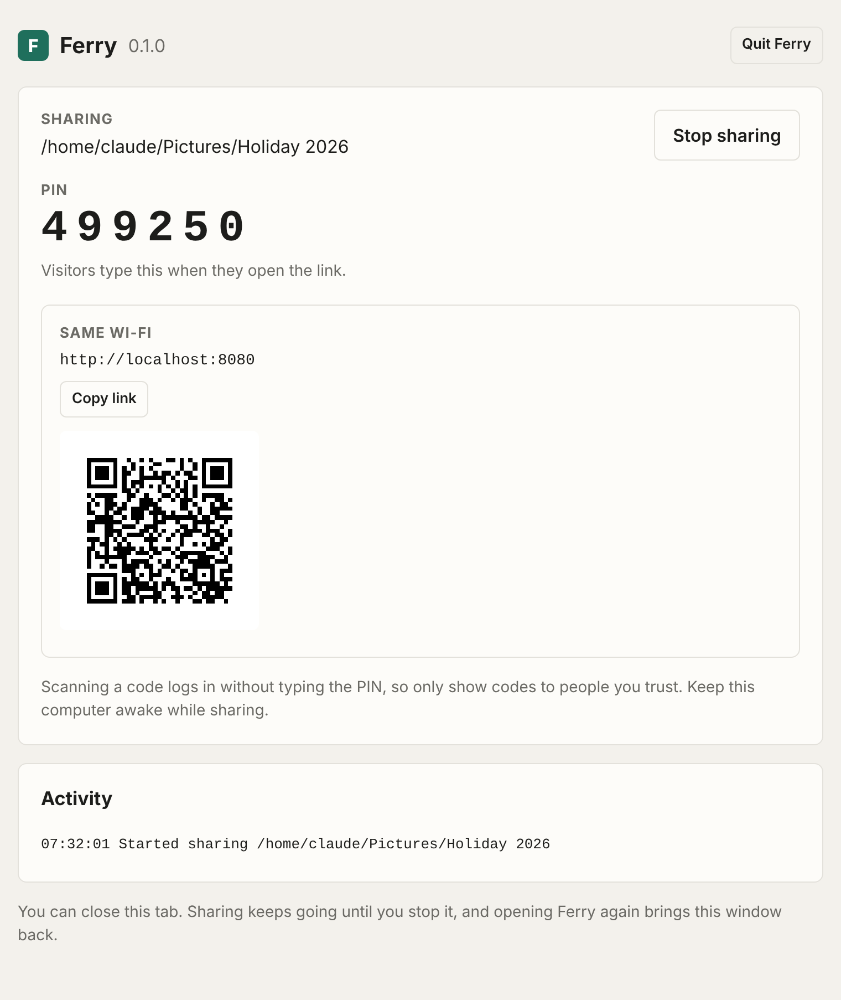

# Ferry

Ferry lets you open a folder or a website from your computer on any other device, just by using its browser. Phones, laptops, a friend's PC: nothing needs installing on their end. It works on the same Wi-Fi, and from anywhere if you switch that on. It's free and there's no account.

I built it because every time I wanted to move a few files between my own devices, or show someone a site I was working on, I ended up reaching for a paid service or a cable.

<p align="center"></p>

## Download

Grab the latest version from the [Releases page](../../releases/latest).

| Computer | File |
| --- | --- |
| Windows | `ferry-windows-x64.exe` (or `ferry-windows-arm64.exe` for ARM laptops, like Snapdragon ones) |
| Mac (Apple Silicon or Intel) | `ferry-mac.zip` |

### Opening it the first time on Windows

Windows will say **"Windows protected your PC"**, because I don't pay for a code signing certificate. Click **More info**, then **Run anyway**.

When you start sharing, Windows asks if Ferry can use the network. Pick **Allow** (private networks), otherwise other devices can't reach it.

### Opening it the first time on Mac

1. Unzip `ferry-mac.zip` and drag **Ferry** into **Applications**.
2. Open it. macOS will say it can't check the app for malware. Click **Done**.
3. Go to **System Settings > Privacy & Security**, scroll down, and click **Open Anyway** next to Ferry. Enter your password.

You only have to do that once. If macOS asks whether Ferry can accept incoming connections, say **Allow**.

## Using it

1. Open Ferry. A short animation plays and then its window opens in your browser.
2. Choose **A folder** or **A website**.
3. Click **Start sharing**.
4. On the other device, scan the QR code, or type in the link and the PIN.

Ferry doesn't sit in the Dock or taskbar. You can close the tab and sharing carries on. Open Ferry again to get the window back, and hit **Stop sharing** or **Quit Ferry** when you're finished. If nothing is being shared and the window has been closed for 3 minutes, it quits on its own.

### Sharing a folder

People can browse it, open or download files, grab a whole folder as a zip, and drag files onto the page to upload them. Pictures show a small thumbnail in the list, and other files show a tag with their type, like PDF or ZIP. You can turn uploads off before you start. Nothing gets overwritten: if someone uploads a second `photo.jpg` it's saved as `photo (1).jpg`.

### Sharing a website

If you've got a site running on your computer, like a dev server on port 3000, Ferry passes visitors through to it so they see exactly what you see. Live reload still works.

### Access from anywhere

Tick **Also allow access from outside this Wi-Fi** and you get a second link that works on any network. It uses a free Cloudflare tunnel. The first time, Ferry downloads Cloudflare's official `cloudflared` program (about 40 MB) and keeps it for next time. The link changes every time you start sharing, and visitors still need the PIN.

### Updates

Each time Ferry opens, it checks GitHub for a newer release. If there is one, it downloads it in the background and the window shows an **Update ready** banner. Click **Restart to update** when it suits you. Ferry restarts on the new version, and your settings are kept. Sharing stops during the restart, so you'll need to start it again. If the check can't reach GitHub, Ferry just tries again next time.

## Keeping it safe

- Nobody gets in without the PIN or one of the QR codes. You get a new PIN every time you start sharing.
- 5 wrong PINs locks that device out for a minute. 30 wrong PINs from anyone pauses all logins for 10 minutes.
- Visitors can't see anything outside the folder you picked.
- The QR codes log people in without the PIN, so only show them to people you trust.
- The Ferry window only opens on your own computer. Other devices can't control it.
- On the same Wi-Fi the connection isn't encrypted, so someone else on that network could in theory see what's being sent. Stick to networks you trust. The anywhere link is encrypted (HTTPS).

## Where it keeps things

Ferry remembers your last choices (folder, port, checkboxes) in a small settings file in your user config folder:

- Windows: `%AppData%\ferry`
- Mac: `~/Library/Application Support/ferry`

The downloaded `cloudflared` goes in your cache folder under `ferry`. Delete either folder to reset it.

## Terminal version

It's the same program, just run from a terminal. Download `ferry-cli-windows-x64.exe`, `ferry-cli-mac-arm64`, `ferry-cli-mac-intel` or `ferry-linux-x64` and run:

```
ferry files                  share the current folder
ferry files ~/Pictures       share a specific folder
ferry site 3000              share a website running on port 3000

  --internet     also give a link that works from anywhere
  --pin 123456   pick the PIN yourself
  --port 8080    pick the port (otherwise the first free one from 8080)
  --read-only    people can download but not upload
```

## If something's not working

- **The other device can't connect.** Make sure both are on the same Wi-Fi (not a guest network) and that Ferry is allowed through the firewall. On Windows that's Settings > Privacy & security > Windows Security > Firewall > Allow an app through firewall.
- **Website mode says "The website is not running".** Start the site on your computer first, double check the port, then reload.
- **The anywhere link never shows up.** It needs a working internet connection and can take up to 45 seconds. Some school and work networks block it.
- **Sharing stops when the computer goes to sleep.** Keep it awake while you're sharing.

## Building it yourself

You'll need [Go](https://go.dev/dl/) 1.24 or newer.

```
go run .                     run the app
go test ./...                run the tests
scripts/build.sh             build everything into dist/
```

The Mac app only comes out universal and signed when `scripts/build.sh mac` runs on a Mac. Pushing a tag like `v0.2.0` makes GitHub build everything and publish a release.

## License

MIT
